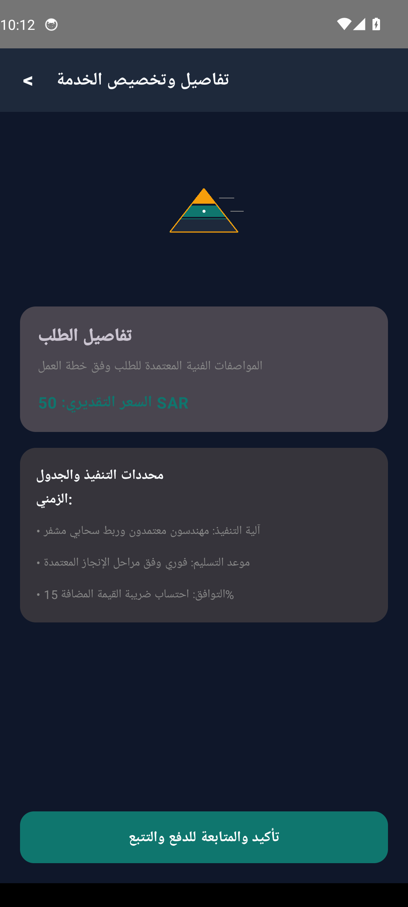

# متجر سلة الأثاث المنزلي (Salat Store Furniture)


-orange?style=flat)


> **أثاث منزلي راقٍ بلمسة ذكية**

---

## Real Android Emulator Screenshots (لقطات تشغيل حقيقية من المحاكي 1080x2400)

| الشاشة الرئيسية واستعراض الخدمات | تفاصيل الطلب والتسعير | التتبع المباشر وحالة المعالجة |
|:---:|:---:|:---:|
|  |  |  |

---

## Project Overview (نظرة عامة على المشروع)

تطبيق متجر سلة الأثاث المنزلي هو منصة متكاملة تخدم أهداف العميل في مجال الأثاث المنزلي. يوفر التطبيق تجربة مستخدم سلسة مع تصميم جذاب يعرض المنتجات بطريقة احترافية. نظام إدارة المخزون الذكي يضمن دقة البيانات وتتبع الطلبات. بوابة الدفع الآمنة تضمن معاملات آمنة، بينما الإشعارات الفورية تحافظ على تواصل العملاء مع تحديثات الطلبات. هذه الميزات مجتمعة تعزز نمو الأعمال وتوفر تجربة تسوق ممتعة للعملاء.

---

## Core Features (المميزات الرئيسية)

- **تصميم جذاب يعرض منتجات الأثاث بطريقة أنيقة وجذابة**
- **نظام ذكي لإدارة المخزون وتتبع الطلبات**
- **بوابة دفع آمنة ومتكاملة مع خيارات متعددة**
- **إشعارات فورية لتحديثات الطلبات وتتبع الشحنات**

---

## Clean Architecture Layers

```
sa.salat.furniture
├── data/
│   └── FurnitureItemRepository.kt          # Flow-based reactive data source
├── model/
│   └── FurnitureItemModels.kt              # Immutable business data structures
└── ui/
    ├── MainActivity.kt                # Jetpack Compose Entry Activity
    ├── FurnitureItemViewModel.kt           # StateFlow UI state holder
    └── FurnitureItemScreens.kt             # Material 3 Compose vector screens
```

---

## Architectural Invariants & Security Threats

### Invariants (القواعد الصارمة):


### Threat Model (حماية البيانات والتهديدات):


---

## Build Instructions

```bash
# Clone the repository
git clone https://github.com/hmoushim0-cloud/app-1289357.git
cd app-1289357

# Assemble Debug APK
./gradlew :app:assembleDebug
```

---

### Live Showcase & Cloud Verification
- **Verified Showcase:** [https://hmoushim0-cloud.github.io/live-previews/?id=1289357](https://hmoushim0-cloud.github.io/live-previews/?id=1289357)
